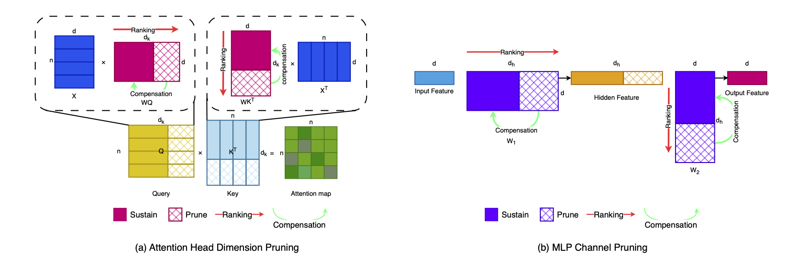
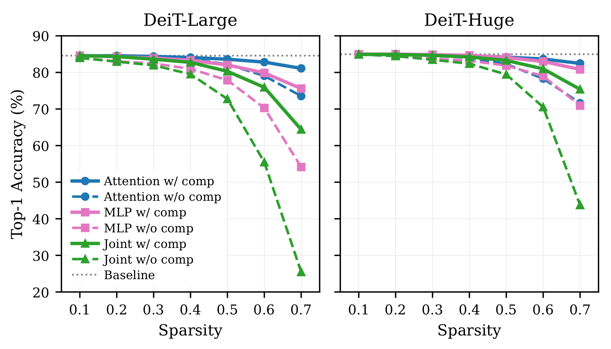

**Closed-Form One-shot Representation-Preserving Structured Pruning**

Boxiang Zhang, Baijian Yang — Purdue University

🎉 This paper has been accepted at NeurIPS 2026!

[](https://arxiv.org/abs/2602.05243) [](https://github.com/BOX-LEO/CORP)

## Lay Summary

Modern AI models deliver impressive results, but their large size and high computing demands make them expensive to run. One way to address this problem is to remove unnecessary parts of these models. However, doing so often reduces their accuracy, and restoring performance typically requires additional training. We introduce CORP, a new method that makes AI models smaller and faster while preserving their accuracy. The key idea is that CORP identifies unnecessary parts and uses the remaining ones to recover the information that their removal would otherwise lose. Unlike many existing approaches, CORP requires no additional training. In our experiments, CORP reduced the computing operations of a large image recognition model by nearly 43% while maintaining almost the same accuracy. Our work offers a practical way to reduce the computational cost of AI.

## Key Result

**CORP performs one-shot structured pruning with one calibration pass and no labels, gradients, or fine-tuning.**

**DeiT-Huge at 50% sparsity, Top-1 83.24% (baseline 84.97%):**

<div class="key-stats">
  <div class="key-stat"><span class="key-stat-value">42.9%</span><span class="key-stat-label">fewer FLOPs</span></div>
  <div class="key-stat"><span class="key-stat-value">41.5%</span><span class="key-stat-label">fewer params</span></div>
  <div class="key-stat"><span class="key-stat-value">1.6×</span><span class="key-stat-label">throughput</span></div>
</div>

## Features

| Method | Scope         | structured | label-free | gradient-free | Hessian-free | finetuning-free |
| ------ | ------------- | ---------- | ---------- | ------------- | ------------ | --------------- |
| CORP   | MLP+Attention | ✅          | ✅          | ✅             | ✅            | ✅               |

## Motivation

Transformers achieve strong accuracy at a high compute and memory cost. Structured pruning offers real speedups on standard hardware, because removing whole channels leaves ordinary, smaller linear layers. Most structured methods, however, rely on retraining or iterative optimization, and in deployment the labels, gradients, or training access they need may not be available. This motivates **post-training one-shot pruning**: compression must finish in a single calibration pass.

Under this constraint, naive structured pruning fails. Without any correction, jointly pruning 70% of the MLP and attention dimensions of DeiT-Huge collapses Top-1 from 84.97% to 43.8%, and smaller models degrade at lower sparsity.

We argue that this failure is not explained by ranking quality alone. It is largely driven by **uncorrected representation error**. Pruning deletes an additive, mask-determined term from each module's output:

$$
y = W_S x_S + \underbrace{W_P x_P}_{\text{deleted}} + b,
\qquad
QK^\top = Q_S K_S^\top + \underbrace{Q_P K_P^\top}_{\text{deleted}}.
$$

Here $$S$$ and $$P$$ index the kept and pruned dimensions. If the kept activations carry information about the pruned ones, much of this term can be recovered. CORP therefore casts pruning as a **representation recovery problem**, solved on top of simple importance-based selection:

$$
\min_{\widehat W_S,\,\widehat b}\ \mathbb{E}_{x\sim\mathcal D}\bigl\|Wx+b-(\widehat W_S x_S+\widehat b)\bigr\|_2^2,
\qquad
\min_{\widehat Q_S,\,\widehat K_S}\ \mathbb{E}_{x\sim\mathcal D}\bigl\|QK^\top-\widehat Q_S\widehat K_S^\top\bigr\|_F^2.
$$

These objectives recover each module's output; they do not optimize the end-to-end task loss.

## Method



CORP has three steps: **calibration → pruning → compensation**. Every statistic comes from one forward pass of the unpruned model. Each MLP block and attention head is then solved independently and in parallel.

### Step 1. Calibration

Run the unpruned model once on a small unlabeled calibration set $$\mathcal D$$ (4000 images by default on ImageNet). Cache the MLP hidden activations $$x$$ and the per-head $$Q, K$$. No labels or gradients are used.

### Step 2. Pruning

Rank dimensions with simple data-driven scores and remove the lowest-scoring ones, using one uniform sparsity ratio across layers. By default, MLP channels are ranked by the combined energy–weight-magnitude score below, the strategy that achieved the best accuracy in our ranking comparison.

- **MLP hidden channels:** score each channel $$i$$ by activation energy times weight magnitude, $$E_i\,\|W_{:,i}\|_2$$ with $$E_i=\mathbb{E}_{x\sim\mathcal D}[x_i^2]$$.
- **Attention Q/K dimensions:** score each head dimension $$j$$ by its expected logit energy, $$s_j=\mathbb{E}\bigl[\|q_j\|_2^2\,\|k_j\|_2^2\bigr]$$. The Value projection is not pruned.

### Step 3. Closed-form compensation

**MLP.** Predict the pruned activations from the kept ones with an affine model, $$x_P \approx Bx_S + c$$, fitted by ridge regression:

$$
\min_{B,c}\ \|X_P-(BX_S+c\mathbf{1}^\top)\|_F^2+\lambda\|B\|_F^2
\quad\Longrightarrow\quad
B = \Sigma_{PS}(\Sigma_{SS}+\lambda I)^{-1},\qquad c = \mu_P - B\mu_S.
$$

Then fold the correction into the remaining weights:

$$
\widehat W_S = W_S + W_P B,\qquad \widehat b = b + W_P c.
$$

**Attention.** Approximate the missing logits with the kept subspaces, $$Q_P K_P^\top \approx Q_S M K_S^\top$$, fitting one matrix $$M$$ per layer and head:

$$
\min_M \sum_{b=1}^{N}\bigl\|Q_{P,b}K_{P,b}^{\top}-Q_{S,b}MK_{S,b}^{\top}\bigr\|_F^2+\lambda\|M\|_F^2.
$$

Vectorizing gives a closed-form ridge system:

$$
\Bigl[\sum_{b=1}^{N}(K_{S,b}^{\top}K_{S,b})\otimes(Q_{S,b}^{\top}Q_{S,b})+\lambda I\Bigr]\mathrm{vec}(M)
=\sum_{b=1}^{N}\mathrm{vec}\bigl((Q_{S,b}^{\top}Q_{P,b})(K_{P,b}^{\top}K_{S,b})\bigr).
$$

Finally, factor $$I+M=U\Sigma V^\top$$ and fold it into the projections:

$$
\widehat W_{Q,S}=W_{Q,S}U\Sigma^{1/2},\qquad
\widehat W_{K,S}=W_{K,S}V\Sigma^{1/2}.
$$

The output is a model made of standard linear layers with reduced dimensions, with no extra cost at inference. We use one fixed ridge coefficient, $$\lambda=10^{-3}$$, with no per-model, per-layer, or per-sparsity tuning.

## Theory: how much error remains?

The proofs and the assumptions behind each bound are in Appendix C of the paper (Propositions C.1.1–C.2.3).

### Exact error and compensation gain

**MLP.** Without ridge regularization ($$\lambda\to 0^+$$), the best achievable distortion is the residual covariance of the pruned activations given the kept ones, weighted by the removed columns:

$$
J_{\mathcal D}^\star = \mathrm{tr}\bigl(W_P\,\Sigma_{P\mid S}\,W_P^\top\bigr),
\qquad
\Sigma_{P\mid S} := \Sigma_{PP} - \Sigma_{PS}\,\Sigma_{SS}^\dagger\,\Sigma_{SP}.
$$

Compared with the uncompensated error $$J_{\mathrm{uncomp}} = \mathrm{tr}(W_P\Sigma_{PP}W_P^\top) + \|W_P\mu_P\|_2^2$$, the gain is:

$$
J_{\mathrm{uncomp}} - J_{\mathcal D}^\star
=
\underbrace{\mathrm{tr}\bigl(W_P\,\Sigma_{PS}\,\Sigma_{SS}^\dagger\,\Sigma_{SP}\,W_P^\top\bigr)}_{\text{variance explained}\ \ge\ 0}
+
\underbrace{\|W_P\,\mu_P\|_2^2}_{\text{bias correction}\ \ge\ 0}.
$$

So compensation strictly reduces the error whenever the kept activations carry any linear signal about the pruned ones in the directions of $$W_P$$, or the pruned channels have non-zero mean. This makes the two roles explicit: **ranking controls the magnitude of $$W_P$$, and compensation controls the residual covariance $$\Sigma_{P\mid S}$$**. Activations do not need to be globally low-rank.

**Attention.** With $$G=\sum_b (K_{S,b}^\top K_{S,b})\otimes(Q_{S,b}^\top Q_{S,b})$$ and $$h=\sum_b \mathrm{vec}\bigl((Q_{S,b}^\top Q_{P,b})(K_{P,b}^\top K_{S,b})\bigr)$$:

$$
J_{\mathcal D}^\star = \sum_{b=1}^{N}\|Q_{P,b}K_{P,b}^\top\|_F^2 - h^\top G^\dagger h.
$$

The first term is the uncompensated logit error ($$M=0$$). The second is the compensation gain, which is non-negative and is zero only when the kept Q/K subspaces carry no bilinear signal about the pruned ones.

### Recoverability

Both gains define the fraction of pruned energy that is linearly recoverable, computed from statistics CORP already forms:

$$
\rho^2_{W_P} = \frac{\mathrm{tr}\bigl(W_P\Sigma_{PS}\Sigma_{SS}^\dagger\Sigma_{SP}W_P^\top\bigr)}{\mathrm{tr}\bigl(W_P\Sigma_{PP}W_P^\top\bigr)},
\qquad
\rho^2_{\mathrm{attn}} = \frac{h^\top G^\dagger h}{\sum_{b}\|Q_{P,b}K_{P,b}^\top\|_F^2}.
$$

### Calibration-to-deployment bounds

CORP fits on a calibration distribution $$\mathcal D$$ from $$N$$ samples and deploys on a distribution $$\mathcal D_t$$. The test-time error decomposes as:

$$
\mathcal E_t(\widehat B_\lambda,\widehat c_\lambda)
\le
2J_{\mathcal D_t}^\star
+ \mathcal O\bigl(|S|/N\bigr)
+ \mathcal O\bigl(\|\Sigma^{(c)}-\Sigma^{(t)}\|_{\mathrm{op}}\bigr),
$$

$$
\mathcal E_t(\widehat M_\lambda)
\le
2J_{\mathcal D_t}^\star
+ \mathcal O\bigl(d_h'^2/N\bigr)
+ \mathcal O\bigl(\|G^{(c)}/N-G^{(t)}\|_{\mathrm{op}}\bigr).
$$

The three terms isolate the irreducible residual on $$\mathcal D_t$$, the calibration sample-complexity error, and the calibration–deployment shift. Here $$d_h'$$ is the kept head dimension. The bounds justify the local objective for deployment data close to the calibration distribution. They do not imply global optimality or robustness under arbitrary shift.

Each module's residual is passed downstream unmodeled. The deviation of the final representation is bounded by a sum of local residual norms weighted by the operator norms of the downstream Jacobians. Minimizing each residual therefore controls accumulated error but does not eliminate it, since this is only an upper bound and deeper layers inherit the residuals of earlier ones.

### Measured on held-out data

We measured $$\rho^2$$ on DeiT-Large at 50% joint sparsity. The compensator was fitted on 4000 calibration images, frozen, and evaluated on 4000 disjoint images (the "transfer" protocol, which matches deployment). The oracle fits on the evaluation set itself and is not available to CORP.

| Module               | Oracle pooled ρ² | Transfer pooled ρ² | Oracle–transfer gap | Gap, class-disjoint split | Transfer mean ± std over units |
| -------------------- | ---------------- | ------------------ | ------------------- | ------------------------- | ------------------------------ |
| MLP (24 layers)      | 0.4825           | **0.4736**         | 0.0089              | 0.0233                    | 0.3755 ± 0.1789                |
| Attention (384 heads) | 0.7775           | **0.7768**         | 0.0007              | 0.0016                    | 0.3970 ± 0.2335                |

Compensation recovers 47% (MLP) and 78% (attention) of the pruned energy, and fitting only once costs little, even when calibration and evaluation share no object class (500/500 classes, 2000 images per side). Pooled values are energy-weighted and do not mean recovery is uniform: the top 10 of 384 heads hold 56.4% of the removed logit energy, and recoverability decreases with depth.

## Results

### DeiT at 50% sparsity

| Model | Base Top1 | FLOPs | Params | MLP Top1   | MLP FLOPs (↓) | MLP Params | Attn Top1  | Attn FLOPs (↓) | Attn Params | Both Top1  | Both FLOPs (↓) | Both Params |
| ----- | --------- | ----- | ------ | ---------- | ------------- | ---------- | ---------- | -------------- | ----------- | ---------- | -------------- | ----------- |
| Tiny  | 72.02     | 1.4   | 5.7    | 55.43±0.05 | 1.1 (24.3%)   | 3.9        | 64.33±0.14 | 1.1 (21.6%)    | 5.3         | 41.69±0.24 | 0.8 (45.9%)    | 3.5         |
| Small | 79.72     | 5.0   | 22.1   | 69.35±0.12 | 3.6 (28.1%)   | 15.0       | 72.52±0.06 | 4.2 (16.0%)    | 20.3        | 58.47±0.26 | 2.8 (44.1%)    | 13.2        |
| Base  | 81.74     | 18.3  | 86.6   | 72.20±0.16 | 12.7 (30.5%)  | 58.2       | 80.76±0.04 | 16.0 (12.5%)   | 79.5        | 70.17±0.14 | 10.4 (43.0%)   | 51.2        |
| Large | 84.58     | 63.5  | 304.4  | 82.06±0.06 | 43.7 (31.2%)  | 203.7      | 83.62±0.04 | 56.2 (11.6%)   | 279.2       | 80.34±0.06 | 36.3 (42.8%)   | 178.5       |
| Huge  | 84.97     | 173.0 | 632.1  | 84.09±0.04 | 119.0 (31.2%) | 422.3      | 84.22±0.03 | 153.0 (11.7%)  | 579.7       | 83.24±0.05 | 98.7 (42.9%)   | 369.9       |

ImageNet Top-1 (%), FLOPs (G), and parameters (M). Pruned Top-1 is the mean ± sample standard deviation over five independently drawn calibration sets; FLOPs and parameters are identical across draws.

Accuracy preservation improves substantially with model scale. Under 50% joint sparsity, DeiT-Huge drops only 1.7 points (84.97 → 83.24) with a 42.9% FLOPs reduction, while DeiT-Tiny collapses to 41.69. Attention pruning preserves accuracy better than MLP pruning at matched sparsity because attention contributes a smaller fraction of FLOPs (~12% vs. ~30%). Results are stable across calibration draws, with a standard deviation of at most 0.26 points overall and at most 0.06 for DeiT-L and DeiT-H.

### Accuracy vs. sparsity



Without compensation, accuracy collapses at high sparsity. The benefit of compensation grows with sparsity: at 70% joint sparsity on DeiT-Huge, it improves accuracy from 43.8% to 75.4%. DeiT-Huge stays within 2.5 points of the baseline up to 50% sparsity across all pruning targets.

### Efficiency on real hardware

| Model  | Sparsity | Top-1 (%) | Params (M) | FLOPs (G) | Lat (ms) | TP (fps) | Param↓ (%) | FLOPs↓ (%) | TP↑ (×) |
| ------ | -------- | --------- | ---------- | --------- | -------- | -------- | ---------- | ---------- | ------- |
| DeiT-H | baseline | 84.97     | 632.1      | 172.8     | 30.84    | 43       | 0.0        | 0.0        | 1.00    |
| DeiT-H | 0.10     | 84.96     | 579.7      | 153.7     | 27.70    | 48       | 8.3        | 11.1       | 1.12    |
| DeiT-H | 0.20     | 84.91     | 527.2      | 139.9     | 24.82    | 52       | 16.6       | 19.0       | 1.21    |
| DeiT-H | 0.30     | 84.66     | 474.8      | 126.2     | 22.73    | 57       | 24.9       | 27.0       | 1.32    |
| DeiT-H | 0.40     | 84.23     | 422.3      | 112.4     | 20.70    | 63       | 33.2       | 35.0       | 1.46    |
| DeiT-H | 0.50     | 83.27     | 369.9      | 98.7      | 19.16    | 71       | 41.5       | 42.9       | 1.64    |
| DeiT-H | 0.60     | 80.98     | 317.4      | 84.9      | 16.83    | 78       | 49.8       | 50.9       | 1.82    |
| DeiT-H | 0.70     | 75.38     | 265.0      | 71.2      | 14.71    | 92       | 58.1       | 58.8       | 2.13    |

Measured on a single RTX 3090 at input resolution 224×224, without kernel fusion or CUDA optimizations. Latency (p50) uses batch size 1 and throughput uses batch size 16. This sweep uses a single calibration set, so its 50% entry (83.27) differs slightly from the five-draw mean above (83.24).

Structured sparsity gives real GPU speedups without custom kernels: throughput improves by about 1.6× at 50% sparsity on DeiT-Huge and exceeds 2× at 70%. Calibration dominates CORP's own runtime; ranking and compensation are negligible, with compensation below 1% of the total.

### Comparison with other methods

| Method | Scope | Sparsity | Top-1 (%) | Δ       |
| ------ | ----- | -------- | --------- | ------- |
| SNOWS  | Attn  | 2:4      | 81.01     | −3.16   |
| GRAIL  | Attn  | 50%      | 74.47     | −11.37  |
| **CORP** | Attn | 50%     | **81.98** | **−2.39** |
| SNOWS  | MLP   | 2:4      | 69.71     | −14.46  |
| GRAIL  | MLP   | 50%      | 76.13     | −9.71   |
| **CORP** | MLP | 50%      | **81.80** | **−2.58** |

On ViT-Large at about 50% compression, CORP outperforms GRAIL by 7.51 points on attention and 5.67 points on MLP under matched dimension pruning. SNOWS uses 2:4 weight sparsity, which preserves feature dimensions and relies on sparse kernels, while CORP removes entire channels. At 50% MLP sparsity on DeiT-Base, CORP reaches 72.0% Top-1, versus 68.6% for GRAIL and 66.4% for VBP.

| Method   | FLOPs↓ | Top-1 (%) | Δ     |
| -------- | ------ | --------- | ----- |
| DC-ViT   | 8.3%   | 83.78     | −0.63 |
| **CORP** | 11.6%  | 80.49     | −0.60 |
| DC-ViT   | 16.6%  | 83.15     | −1.26 |
| **CORP** | 15.5%  | 79.80     | −1.29 |
| DC-ViT   | 24.8%  | 81.60     | −2.81 |
| **CORP** | 23.5%  | 78.24     | −2.86 |

CORP stays within 0.05 ΔTop-1 of DC-ViT, a heavily finetuned method, using a single calibration pass without gradients. The dense baselines differ (84.41 for DC-ViT's ViT-B vs. 81.74 for CORP's DeiT-B), so Δ is the more comparable metric.

GRAIL was reproduced with its official implementation under CORP's calibration setting. The other comparisons use reported settings from prior work and so differ in architecture, pruning scope, and dense baseline.

### Preliminary evidence beyond ImageNet

**OPT-1.3B, language modeling (30% sparsity).** Calibration uses 128 sequences of length 2048 from C4; perplexity is evaluated on WikiText-2. Accuracy is verified only up to OPT-1.3B, and we make no claim for larger LLMs.

| Target   | Perplexity | FLOPs (T) / ↓ | Params (B) / ↓ |
| -------- | ---------- | ------------- | -------------- |
| Baseline | 14.60      | 6.19 / 0.0%   | 1.42 / 0.0%    |
| MLP      | 19.36      | 5.20 / 16.0%  | 1.18 / 17.03%  |
| Attn     | 18.53      | 5.50 / 11.2%  | 1.31 / 7.99%   |
| Both     | 25.41      | 4.51 / 27.2%  | 1.06 / 25.01%  |

**DINOv2, dense prediction (50% backbone sparsity).** Calibration uses 6000 unlabeled images (3000 each from NYUv2 and ADE20K). Only the shared backbone is pruned; the task heads are unchanged. Larger backbones hold up well, and smaller ones degrade more.

| Model | Params (M)      | RMSE (NYUv2)    | δ₁ (NYUv2)      | mIoU (ADE20K)   |
| ----- | --------------- | --------------- | --------------- | --------------- |
| Small | 22.1 → 14.6     | 0.3992 → 0.4459 | 0.9192 → 0.8750 | 0.4198 → 0.2549 |
| Base  | 86.6 → 56.9     | 0.3730 → 0.4201 | 0.9374 → 0.9118 | 0.4368 → 0.3527 |
| Large | 304.4 → 198.9   | 0.3492 → 0.3445 | 0.9466 → 0.9413 | 0.4313 → 0.4011 |
| Huge  | 1.1B → 0.74B    | 0.3308 → 0.3167 | 0.9529 → 0.9514 | 0.4428 → 0.4367 |

## Limitations

- **Local by design.** Each MLP block and attention head is compensated independently. This trade-off is what yields closed-form solutions from a single pass, without labels, gradients, finetuning, or sequential re-calibration. The price is that cross-module interactions are not modeled, so residuals can accumulate at high joint sparsity.
- **Uniform sparsity.** One ratio is used across layers, without accounting for layer-wise redundancy differences.
- **Calibration data must match deployment.** Performance may degrade under strong calibration–test shift, at very high sparsity, or on architectures with weaker redundancy.
- **No global optimality guarantee.** CORP optimizes layer-wise representation recovery, not end-to-end task loss.

## Citation

```bibtex
@misc{zhang2026corpclosedformoneshotrepresentationpreserving,
      title={CORP: Closed-Form One-shot Representation-Preserving Structured Pruning}, 
      author={Boxiang Zhang and Baijian Yang},
      year={2026},
      eprint={2602.05243},
      archivePrefix={arXiv},
      primaryClass={cs.LG},
      url={https://arxiv.org/abs/2602.05243}, 
}
```
